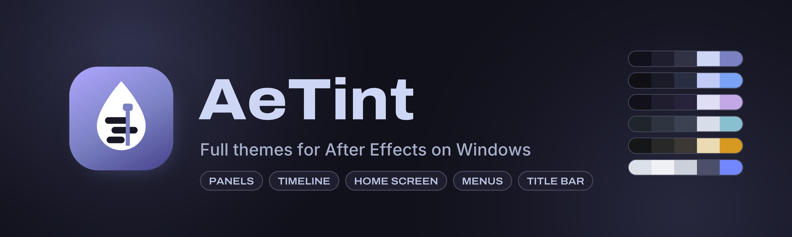
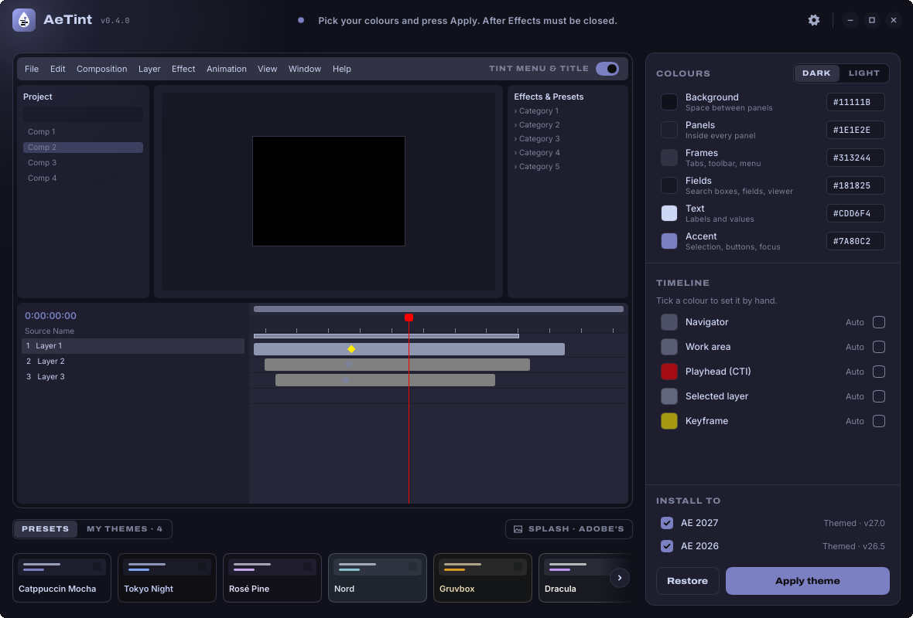
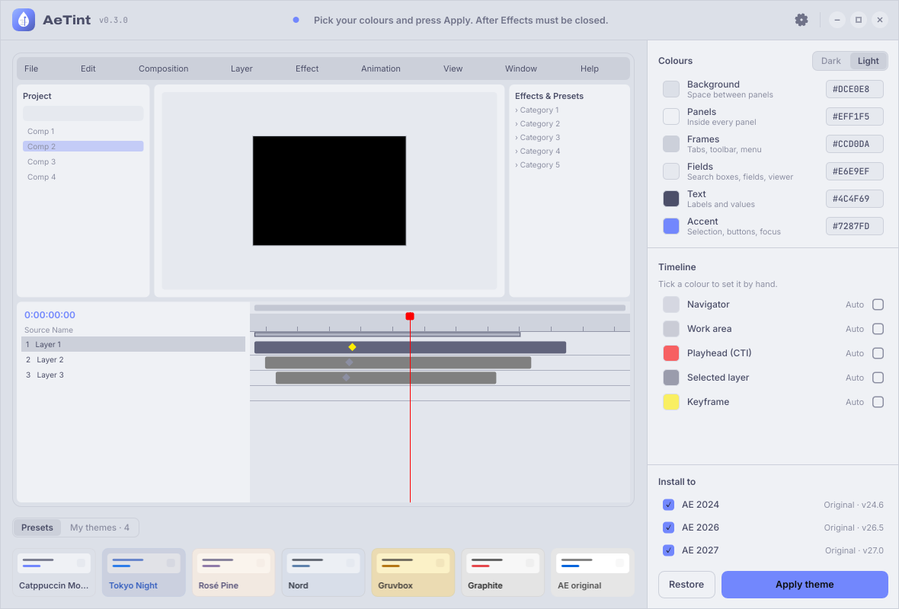
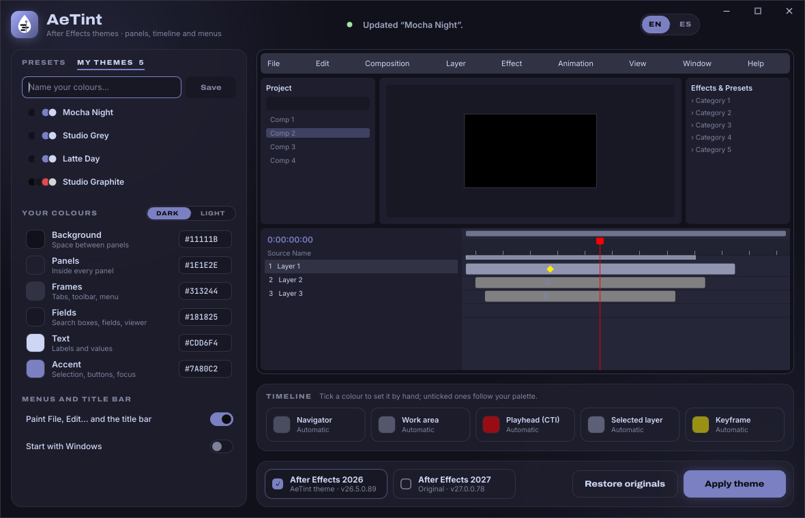
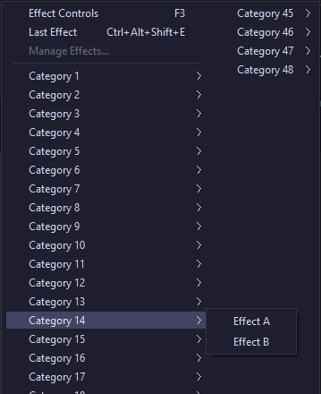

<p align="center">
  
</p>

<p align="center">
  
  
  
  
</p>

<p align="center">
  <b>Recolour After Effects with your own palette — including the parts other theming tools can't reach:</b><br>
  the timeline's time navigator, the Home screen, the File / Edit… menus and the title bar.
</p>

---

<p align="center">
  
  
</p>

## What it themes

| Area of After Effects | Where the colour lives | How AeTint changes it | Lasts |
|---|---|---|---|
| Panels, buttons, fields, lists | `dvaui.dll` — colour tables per brightness | Rewrites the numbers in place (same file size) | Until you restore |
| Timeline: time navigator, ruler, work area, playhead, layer bars, graph editor | `AfterFXLib.dll` — the `AE-SPECTRUM-COLORTHEMES` table (~120 colours) | Rewrites that table (same file size) | Until you restore |
| Home screen | UXP plugin `com.adobe.ccx.start` — Spectrum stylesheets | Recolours only the rules for each brightness | Until you restore |
| File / Edit… menus, dropdowns, title bar | Windows (Win32 menus + DWM) | `aetint_menu.dll`, loaded by the `AeTint.aex` plugin | While AE is open |

## Features

- **One palette, everywhere.** Six colours — background, panels, frames, fields, text and accent — drive hundreds of Adobe greys. Each grey lands between your colours by lightness, so every in-between shade follows the palette.
- **Dark and light.** Every theme has a **Dark** palette (AE's *Darkest* and *Dark*) and a **Light** palette (AE's *Light*). Switch brightness in AE and the menus and title bar follow live.
- **Presets** with both versions: Catppuccin Mocha / Latte, Tokyo Night / Day, Rosé Pine / Dawn, Nord / Snow Storm, Gruvbox dark / light, Graphite, and AE's own colours.
- **My themes** — save your palettes (including hand-picked timeline colours) and switch with one click.
- **Timeline overrides** for the navigator, work area, playhead, selected layer and keyframe.
- **Live preview** of After Effects inside the app.
- **Menus that actually match**: menu bar, dropdowns, multi-column menus like *Effect*, borders, separators, hover and the title bar.
- **Safe by design**: originals are backed up and **Restore originals** puts them back. Nothing is written if a file doesn't look the way AeTint expects.
- **English and Spanish** UI, custom title bar, no scrolling.

<p align="center">
  
  &nbsp;
  
</p>

## Getting started

### Install

Download **`AeTint-Setup.exe`** from the [latest release](https://github.com/xjuanfxx/AeTint/releases/latest) and run it. It installs AeTint for your user in `%LOCALAPPDATA%\Programs\AeTint` (no administrator rights needed), adds Start menu / desktop shortcuts and an entry in **Settings → Apps** to uninstall it. Running a newer setup updates AeTint in place.

The uninstaller can restore After Effects to its original colours (removing the `AeTint.aex` plugin) and optionally delete your settings and saved themes.

AeTint checks GitHub for new releases when it opens; when there is one, an **Update** badge appears next to the logo.

Prefer a portable copy? `AeTint-windows-x64.zip` has the same three files.

### Requirements

- Windows 10 or 11
- After Effects 2026 or 2027 (2025 is very likely to work — same Spectrum UI)
- [Rust](https://rustup.rs) to build it yourself

### Build

```bash
git clone https://github.com/xjuanfxx/AeTint.git
cd AeTint
cargo build --release --workspace --exclude aetint_setup
cargo build --release -p aetint_setup   # the installer embeds the files built above
```

Everything ends up in `target\release`. Keep these three files together:

| File | What it is |
|---|---|
| `AeTint.exe` | The app |
| `aetint_menu.dll` | Paints the menus and title bar inside After Effects |
| `aetint_loader.dll` | Installed into AE as `AeTint.aex` — loads the DLL above when AE starts |

### Use

1. **Close After Effects.**
2. Open `AeTint.exe`, pick a preset (or your own colours) and check both **Dark** and **Light**.
3. Tick the installations to theme and press **Apply theme**. The first time, Windows asks for administrator permission to write to `Program Files`.
4. Keep **Paint File, Edit… and the title bar** on to theme the menus.
5. Open After Effects.

To undo everything, press **Restore originals**.

> **After Effects updates** replace Adobe's files with new, unthemed ones. Press **Apply theme** again after updating.

## How it works

<details>
<summary><b>Panels — <code>dvaui.dll</code></b></summary>

AeTint finds the table of Spectrum colour token names (`gray-50` … `gray-900`, `background-layer-2-color`, …) and the float RGBA tables for each brightness. Every opaque grey is mapped through a lightness curve anchored on your palette; accent blues are rotated to your accent in OKLCh. The dark tables use the dark palette and the light tables use the light one, where the curve is inverted (light panels, dark text). The file keeps its exact size and its PE checksum is recomputed.
</details>

<details>
<summary><b>Timeline — <code>AfterFXLib.dll</code></b></summary>

The `AE-SPECTRUM-COLORTHEMES` JSON resource holds the timeline's `ae-color-*` values in `light`, `dark` and `darkest` blocks. AeTint rewrites them through the same mapping, compacts the JSON and pads it with spaces so the resource keeps its length.
</details>

<details>
<summary><b>Home screen — UXP plugin</b></summary>

The Home screen is Adobe's `com.adobe.ccx.start` UXP plugin. Its stylesheets come both as CSS and as pre-parsed JSON. Each rule declares its brightness (`.spectrum--darkest …`, `.spectrum--light …`), so only the colours of each brightness change, plus the global grey scales defined in `:root`.
</details>

<details>
<summary><b>Menus and title bar — <code>aetint_menu.dll</code> + <code>AeTint.aex</code></b></summary>

`AeTint.aex` is a minimal After Effects plugin (a general AEGP with its own PiPL resource). AE loads it at startup and it loads `aetint_menu.dll`, so nothing is injected and nothing runs in the background. Inside AE, the DLL:

- paints the menu bar (`WM_UAHDRAWMENU` / `WM_UAHDRAWMENUITEM`);
- turns dropdown items owner-drawn when each menu opens — including multi-column menus, which Windows draws without visual styles;
- hooks uxtheme for backgrounds, borders and separators, and sets the title bar colours through DWM;
- reads AE's *User Interface Brightness* preference to pick the dark or light colours, and reloads `%LOCALAPPDATA%\AeTint\menu.json` live.

If an installed AE version doesn't have the plugin, AeTint starts a fallback watcher that sleeps until Windows reports a new window and only acts on After Effects. While it runs it shows the AeTint icon in the system tray (double-click opens AeTint; right-click lets you stop it).
</details>

<details>
<summary><b>Originals and safety</b></summary>

AeTint always themes **from the original file**, never on top of a theme:

- a clean file is used as-is and backed up to `%LOCALAPPDATA%\AeTint\originals`;
- a file AeTint wrote is rebuilt from that backup;
- a file themed by another tool is rebuilt from its saved original, or left alone with a clear error.

Everything is located by name, not by fixed offsets, so different builds work as long as Adobe keeps the format. Every written file is verified byte for byte.
</details>

## Compatibility

| Version | Panels & timeline | Home screen | Menus & title bar |
|---|:---:|:---:|:---:|
| After Effects 2027 | ✅ tested | ✅ tested | ✅ |
| After Effects 2026 | ✅ tested (26.5) | ✅ tested | ✅ tested |
| After Effects 2025 | 🟡 very likely | 🟡 very likely | ✅ |
| 2024 and earlier | ❔ older UI | ❔ | ✅ |

Menus and the title bar belong to Windows, so they work with any version.

## Development

```text
src/                 the app: colour engine, PE parsing, dvaui / AfterFXLib / UXP rewriters, installer
ui/app.slint         the interface
crates/menuhook      aetint_menu.dll — menus and title bar inside After Effects
crates/loader        aetint_loader.dll → AeTint.aex — the startup plugin
crates/menutest      a Win32 test window with AE-like menus
crates/setup         AeTint-Setup.exe — installer and uninstaller with the app's look
```

```bash
cargo test --workspace
target\release\AeTint.exe --dry-run out-folder        # build themed files into a folder, install nothing
target\release\menutest.exe --open --menu 4 --dll target\release\aetint_menu.dll
```

Create `%LOCALAPPDATA%\AeTint\debug.flag` to make the DLL log to `%LOCALAPPDATA%\AeTint\menu.log`; the plugin logs to `loader.log`.

## FAQ

<details>
<summary><b>Why is there an AeTint icon in the system tray / an <code>AeTint.exe</code> in Task Manager?</b></summary>

That's the **menu watcher** (`AeTint.exe --watch`). It only exists as a fallback:

- Normally the menus and title bar are painted by the **`AeTint.aex` plugin**, which After Effects loads by itself at startup. Nothing runs in the background in that case.
- If an installed After Effects version **doesn't have the plugin** (a version you haven't applied a theme to yet, or a newly installed one), AeTint starts the watcher so that version's menus still get painted.
- The tray icon is there so it's clear what that process is. Double-click it to open AeTint; right-click → **Stop** to close it (it comes back the next time AeTint opens if it's still needed).

To make it go away for good, select every After Effects version in AeTint and press **Apply theme** once: with the plugin installed everywhere, the watcher isn't started any more.
</details>

<details>
<summary><b>Does the watcher slow my PC down?</b></summary>

No. It doesn't poll: it sleeps until Windows reports that a window appeared, checks in microseconds whether it belongs to After Effects, and goes back to sleep. Measured over 25 minutes it used **0.22 s of CPU in total** and ~13 MB of RAM. Windows delivers those notifications asynchronously, so it can't hold up other programs.
</details>

<details>
<summary><b>What is <code>AeTint.aex</code> in my After Effects <code>Plug-ins</code> folder?</b></summary>

A tiny general plugin (AEGP) whose only job is to load `aetint_menu.dll` from AeTint's install folder when After Effects starts, so the menus are themed from the very first frame without injection or a background process. It reads the DLL's location from `%LOCALAPPDATA%\AeTint\dll_path.txt`, which AeTint updates every time it opens. **Restore originals** and the uninstaller remove it. It doesn't show up in *Manage Effects* because it isn't an effect.
</details>

<details>
<summary><b>Why does it ask for administrator permission?</b></summary>

After Effects lives in `C:\Program Files`, which only administrators can write to. The first **Apply theme** asks once, writes the themed files and gives your user permission to update **those specific files** later, so it doesn't ask again. Installing AeTint itself never needs admin: it goes to `%LOCALAPPDATA%\Programs\AeTint`.
</details>

<details>
<summary><b>Where does AeTint keep my data?</b></summary>

| Path | What |
|---|---|
| `%LOCALAPPDATA%\Programs\AeTint` | The app (installer) |
| `%LOCALAPPDATA%\AeTint\config.json` | Your palettes, language and options |
| `%LOCALAPPDATA%\AeTint	hemes.json` | **My themes** |
| `%LOCALAPPDATA%\AeTint\originals` | Backups of Adobe's original files — needed by **Restore originals** |
| `%LOCALAPPDATA%\AeTint\menu.json` | Menu and title bar colours read live by the DLL |
</details>

<details>
<summary><b>After Effects updated and the theme is gone</b></summary>

Updates replace Adobe's files with new, unthemed ones. Open AeTint and press **Apply theme** again; it detects the new files as originals and backs them up first.
</details>

<details>
<summary><b>My antivirus flagged AeTint</b></summary>

The fallback watcher loads a DLL into After Effects, which some antivirus heuristics dislike. The plugin path (`AeTint.aex`) avoids that. All of AeTint is open source and built by GitHub Actions from this repository.
</details>

<details>
<summary><b>How do I undo everything?</b></summary>

Press **Restore originals** in AeTint, or uninstall it from **Settings → Apps** with *Restore After Effects to its original colours* enabled. Both put Adobe's files back and remove the plugin.
</details>

## Known limitations

- On Windows 11, the light menu outline can take a moment to pick up the theme colour.
- Light/dark switching for menus follows AE's saved preference, so it may lag a few seconds behind the change.
- Hand-picked timeline colours apply to the dark brightnesses only.

## Credits

- Built with [Slint](https://slint.dev) and Rust.
- Fonts: [Inter](https://rsms.me/inter/), [Archivo](https://github.com/Omnibus-Type/Archivo) and [JetBrains Mono](https://www.jetbrains.com/lp/mono/) — SIL Open Font License (`ui/fonts`).
- Palettes from [Catppuccin](https://catppuccin.com), [Tokyo Night](https://github.com/enkia/tokyo-night-vscode-theme), [Rosé Pine](https://rosepinetheme.com), [Nord](https://www.nordtheme.com) and [Gruvbox](https://github.com/morhetz/gruvbox).
- The `dvaui.dll` colour-table approach was inspired by Nothi Theme; AeTint is an independent implementation.

AeTint is not affiliated with or endorsed by Adobe. After Effects is a trademark of Adobe Inc.

## License

[GPL-3.0](LICENSE)
